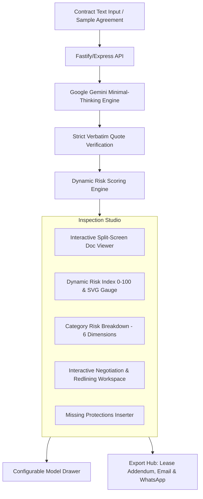

# 🛡️ Agreement RedFlag Reader
### Dynamic Contract Risk Analysis & Interactive Negotiation Studio

> **Hacktoberfest 2026 Hack Day Mumbai**  
> **Author & Maintainer:** Swar Shinde  
> **Repository:** [Swarspage/hacktober-project](https://github.com/Swarspage/hacktober-project)

---

## 📌 Executive Overview

The legal technology industry has long suffered from an asymmetry of information: corporate landlords and institutional property managers routinely employ dense, one-sided contracts loaded with predatory clauses, while tenants and everyday signatories lack the tools to effectively **analyze**, **quantify**, and **negotiate** those terms.

**Agreement RedFlag Reader** is an advanced LegalTech AI platform built for the **Hacktoberfest 2026 Hack Day Mumbai**. It bridges this gap by providing an end-to-end contract intelligence pipeline tailored for Maharashtra Leave & Licence agreements and residential leases.

Unlike simple text summaries or generic chat bots, Agreement RedFlag Reader features:
1. **Verbatim Quote Verification & Hallucination Filter**: Strictly extracts only clauses that physically exist in the source text, discarding unverified model claims.
2. **Configurable Dynamic Risk Score Calculation Engine**: A transparent mathematical scoring index (0–100) with configurable severity weights, category multipliers, and risk thresholds.
3. **Interactive Negotiation & Legal Redlining Studio**: Allows signatories to mark clauses, customize counter-proposals in real-time, view dynamic post-negotiation projected score improvements, and export binding legal addendums, landlord emails, and broker WhatsApp summaries.
4. **Bilingual Engine (English & हिन्दी)**: Full localization for Mumbai & Maharashtra tenancy ecosystems.

---

## ⚡ Key Capabilities & Architecture



### 1. Dynamic Risk Score Calculation Engine
The system replaces arbitrary "low/medium/high" labels with a mathematical, explainable risk index:
- **Numerical Risk Score (0 to 100)**: Scaled through an asymptotic logarithmic response curve to reflect real-world compound liabilities.
- **Explainable Grades**: `A+` / `A` (Tenant-Favorable), `B+` / `B` (Moderate Caution), `C` (High Risk), `D` / `F` (Severe / Predatory).
- **Categorical Breakdown (6 Core Dimensions)**:
  - 💰 **Financial & Security Deposit** (Arbitrary deductions, delayed refunds, unagreed escalation)
  - 🔒 **Lock-in & Termination** (Premature exit penalties, forfeiture traps, asymmetric notice periods)
  - 🛠️ **Maintenance & Structural Repairs** (Shifting major society/seepage liabilities onto tenant)
  - 👁️ **Privacy & Landlord Entry** (Unannounced inspections, key retention, broker visits at all hours)
  - 👥 **Rules, Guests & Subletting** (Arbitrary visitor bans, bachelor restrictions)
  - ⚖️ **Registration & Legal Compliance** (Stamp duty split, police verification responsibility)

### 2. User-Configurable Scoring Model
Every tenant has different priorities. Users can configure the risk engine on the fly via the **Model Configuration Drawer**:
- **Preset Sensitivity Profiles**:
  - 🛡️ **Standard Tenant (Balanced)**: Standard Maharashtra model tenancy practices.
  - ⚡ **Zero-Tolerance (Strict / Risk-Averse)**: Heavy penalties for lock-ins and deposit retention delays.
  - 🏢 **Pragmatic / Commercial (Flexible)**: Prioritizes core monetary expenses while allowing flexibility on operational rules.
  - 🎛️ **Custom Mode**: Interactive sliders for exact severity point weights, category multipliers, and risk boundaries.
- **Instant Reactive Recalculation**: Adjusting sliders dynamically updates gauges, risk grades, and category bars in real-time with zero backend latency.

### 3. Interactive Negotiation & Redlining Studio
- **Clause Negotiation State Machine**: Toggle clause states between `🔴 To Negotiate`, `⚠️ Must-Change (Dealbreaker)`, `✓ Agreed by Owner (Resolved)`, and `⚪ Waived (Accept Risk)`.
- **Live Post-Negotiation Projected Score**: Watch your contract risk drop dynamically as you resolve one-sided terms (e.g., from `84/100 (High)` down to `22/100 (Safe)`).
- **In-Place Legal Redlining**: Edit and customize the suggested replacement clauses directly within the card interface.
- **Comprehensive Multi-Format Export Hub**:
  1. 📑 **Formal Lease Addendum / Amendment Document**: Formally structured legal document with numbered substitution clauses and signature lines.
  2. 📧 **Executive Landlord Negotiation Email**: Authoritative, courteous negotiation email tailored for landlords.
  3. 💬 **Broker WhatsApp Summary**: Concise, bullet-pointed format optimized for quick messaging with property brokers.
  4. 📊 **Full Risk & Compliance Audit Certificate**: Complete record of all flagged terms and mitigation steps.

### 4. Missing Protections Detector
Flags critical clauses that the contract *failed to mention* (e.g., refund deadline within 7 days, 24-hour written notice prior to entry, structural damage exclusions). Offers a 1-click **"Copy Protective Clause"** feature to immediately insert missing safeguards into the addendum.

---

## 🛠️ Technology Stack

| Layer | Technologies Used |
| :--- | :--- |
| **Frontend** | React 19, Vite 8, React Router v7, Modern Vanilla CSS (Design Tokens, Glassmorphism, Micro-animations) |
| **Backend** | Node.js, Express, CORS, Dotenv |
| **AI Engine** | Google GenAI SDK (`@google/genai`) using Gemini / Gemma minimal-thinking model |
| **Quality & Linter** | Oxlint (0 errors, sub-50ms execution) |
| **Security & Privacy** | Ephemeral memory processing, zero document persistence, strictly verified quotes |

---

## 📂 Project Structure

```
hacktober-project/
├── client/                      # Frontend Application (React + Vite)
│   ├── src/
│   │   ├── components/
│   │   │   ├── DocumentViewer.jsx         # Verbatim highlighted interactive text viewer
│   │   │   ├── FlagCard.jsx               # Base flag card component
│   │   │   ├── MissingClausesSection.jsx  # Missing protections & clause inserter
│   │   │   ├── Navbar.jsx                 # Site header with language & score indicator
│   │   │   ├── NegotiationCard.jsx        # Interactive negotiation & redlining card
│   │   │   ├── NegotiationExportModal.jsx # Addendum, email & WhatsApp generator
│   │   │   └── RiskScoreGauge.jsx         # Dynamic circular SVG meter & breakdown bars
│   │   ├── context/
│   │   │   └── AnalysisContext.jsx        # Central state, sample manager & engine sync
│   │   ├── pages/
│   │   │   ├── HomePage.jsx               # Executive landing, input card & sample loader
│   │   │   └── ReportPage.jsx             # Split-screen inspection & negotiation studio
│   │   ├── services/
│   │   │   └── riskEngine.js              # Mathematical scoring model & presets
│   │   ├── App.jsx                        # Application routing shell
│   │   ├── index.css                      # Unified design system & responsive styling
│   │   ├── main.jsx                       # React entry point
│   │   ├── samples.js                     # 6 curated real-world Mumbai tenancy samples
│   │   └── useAnalyze.js                  # Robust async request lifecycle hook
│   └── package.json
│
├── server/                      # Backend API (Express + Google GenAI)
│   ├── .env.example             # Environment variables template
│   ├── index.js                 # API server with quote verification pipeline
│   ├── test.js                  # Integration test script for GenAI API
│   └── package.json
│
├── samples/                     # Real-world benchmark agreement files
│   ├── agreement_1_safe_balanced.txt
│   ├── agreement_2_safe_standard.txt
│   ├── agreement_3_moderate_lockin_delay.txt
│   ├── agreement_4_moderate_deductions_escalation.txt
│   ├── agreement_5_high_risk_penalties.txt
│   └── agreement_6_critical_predatory_traps.txt
│
└── README.md                    # Detailed documentation
```

---

## 🚀 Quickstart & Setup Guide

### Prerequisites
- **Node.js** (v18.0.0 or higher recommended)
- **npm** (v9 or higher)
- **Google AI Studio API Key** ([Get one here](https://aistudio.google.com/))

### 1. Clone & Install Dependencies

```bash
# Clone the repository
git clone https://github.com/Swarspage/hacktober-project.git
cd hacktober-project

# Install root, client, and server dependencies
npm install --prefix client
npm install --prefix server
```

### 2. Configure Environment Variables

Create a `.env` file in the `server/` directory:

```bash
# server/.env
GOOGLE_API_KEY=your_google_gemini_api_key_here
PORT=5000
GEMMA_MODEL=gemma-4-26b-a4b-it
```

### 3. Launch Development Servers

You can run both client and server simultaneously:

```bash
# Terminal 1: Run Backend API
npm run server
# -> Server running on port 5000

# Terminal 2: Run Client Dev Server
npm run dev
# -> Local: http://localhost:5173/
```

Open [http://localhost:5173/](http://localhost:5173/) in your browser.

---

## 🧪 Benchmark Verification Agreements

The project includes 6 pre-configured Maharashtra benchmark agreements in the studio dropdown to immediately test all risk profiles:

| Benchmark Agreement | Risk Profile | Target Detected Concerns |
| :--- | :--- | :--- |
| **Agreement 1: Safe & Balanced** | Low Risk (~15/100, Grade A+) | Clean mutual notice, 7-day deposit refund, reasonable society maintenance split. |
| **Agreement 2: Standard Safe** | Low Risk (~22/100, Grade A) | Standard 11-month term, mutual exit rights, normal wear-and-tear exceptions. |
| **Agreement 3: Moderate Lock-in** | Moderate (~42/100, Grade B) | 6-month lock-in with penalty, 30-day deposit refund delay. |
| **Agreement 4: Deductions & Escalation** | Moderate (~54/100, Grade B-) | 10% annual rent escalation, mandatory painting deductions regardless of condition. |
| **Agreement 5: High Risk Penalties** | High Risk (~76/100, Grade C) | 12-month lock-in with full deposit forfeiture, day/night entry without notice. |
| **Agreement 6: Critical Predatory Traps** | Critical (~92/100, Grade F) | Structural repair liability shifted to tenant, deposit refund at owner's discretion, unilateral eviction rights. |

---

## 🔒 Privacy & Legal Disclaimer

- **Zero Data Retention**: Uploaded agreement texts are processed in-memory and are never stored in any persistent database.
- **Verbatim Grounding**: The AI model is strictly prohibited from inventing clauses. Any clause flagged by the model that does not match the agreement verbatim is automatically discarded.
- **Legal Notice**: Agreement RedFlag Reader is an assistive LegalTech auditing tool designed for informational purposes and negotiation support. It does not constitute formal legal representation or legal advice.

---

## 👨‍💻 Author

**Swar Shinde**  
*Hacktoberfest 2026 Hack Day Mumbai*  
GitHub: [@Swarspage](https://github.com/Swarspage)
